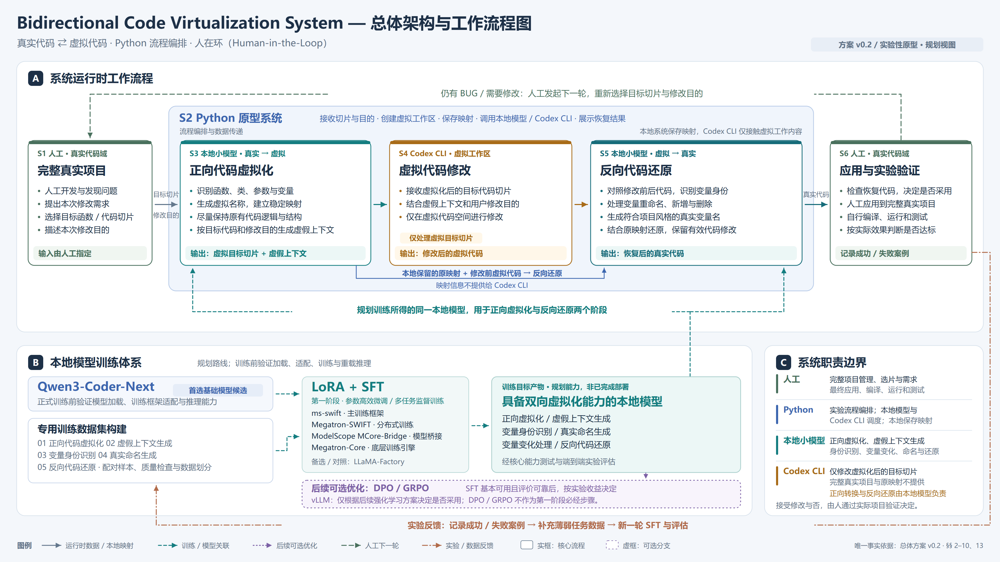

# Bidirectional Code Virtualization System

**双向代码虚拟化系统**

> **让 AI 修改虚拟代码，让真实项目由你掌控。**

Bidirectional Code Virtualization System 探索一种通过本地模型完成代码转换的 AI 辅助编程方式：将用户选定的真实代码切片转换为虚拟代码，交给 Codex CLI 完成修改，再由本地模型将修改结果还原为真实代码，供用户检查、应用和验证。

项目希望在利用 AI 代码修改能力的同时，减少完整真实项目及原始命名信息向外部工具的暴露。按照方案，**Codex CLI 只处理虚拟化后的目标代码切片，真实名称映射由本地系统保存。**

**项目状态：** 实验规划与原型验证。下文介绍总体方案 v0.2 的设计与研究目标。

## 总体架构

*点击图片可查看 SVG 矢量版。图中实线表示运行时数据流，不同虚线区分模型训练、可选优化与实验反馈。*

## 核心思想：在虚拟代码空间中完成修改

本项目中的“代码虚拟化”，是将真实代码切片中的项目内部标识符转换为虚拟名称，建立真实名称与虚拟名称之间的映射，并尽量保持代码原有的逻辑和结构。本地小模型同时根据目标代码与修改目的生成必要的虚假上下文，为 Codex CLI 提供完成当前任务所需的接口和调用环境。

一次修改沿着以下路径进行：

**人工选择真实代码切片 → 本地模型正向虚拟化 → Codex CLI 修改虚拟代码 → 本地模型反向还原 → 人工应用与验证。**

“双向”的关键在于修改后的还原。Codex CLI 可能重命名变量、增加变量或删除变量。本地模型需要结合修改前后的虚拟代码及原映射，重新判断变量身份，恢复原有名称，为新增变量生成符合项目风格的真实名称，并尽量保留 Codex 对代码逻辑所做的有效修改。

整个流程由 Python 原型系统串联，各组件具有明确的职责：

| 参与者 | 在系统中的职责 |
| --- | --- |
| **人工** | 管理完整真实项目，提出修改需求，选择目标切片；检查并决定是否采用恢复结果，将代码应用到项目，负责编译、运行和测试。 |
| **Python 原型系统** | 接收切片与修改目的，调用本地模型，创建虚拟工作区并启动 Codex CLI；在本地保存映射、传递修改前后代码，向用户展示还原结果。 |
| **本地小模型** | 正向虚拟化、虚假上下文生成、变量身份识别、变量变化处理、真实命名生成与反向代码还原。 |
| **Codex CLI** | 根据修改目的，在虚拟工作区中阅读和修改虚拟化后的目标代码切片。 |

**代码转换与还原由本地模型负责。Codex CLI 不直接修改完整真实项目，也不接收真实名称映射；最终是否接受修改，由人通过真实项目的实际运行效果判断。**

## 设计创新与研究重点

### 1. 将双向代码转换作为专门的模型学习任务

系统把正向虚拟化与修改后的反向还原纳入同一条工作流程，通过专用数据集训练本地模型学习真实代码与虚拟代码之间的转换关系。训练目标覆盖名称映射、变量身份理解和真实代码生成，使转换能力能够接受独立评估，并在完整修改任务中验证。

这项设计关注的核心问题是：**代码经过外部 AI 修改后，本地模型能否仍然恢复出保留有效修改的真实代码。**

### 2. 用任务驱动的虚假上下文支持代码修改

当目标切片缺少必要的开发上下文时，方案由本地模型根据当前代码和修改目的，生成虚假函数、类、变量、数据结构、依赖、调用环境或测试数据。

这些上下文服务于当前任务，并与目标虚拟代码的接口和逻辑关系尽量保持一致。方案要求在 Codex 缺少上下文时，**通过虚假上下文补充任务信息，不自动扩大真实代码切片范围**。虚假上下文能否支持有效修改，也是模型训练和测试的一部分。

### 3. 理解变量身份变化，恢复符合项目风格的命名

变量的名称发生变化后，本地模型需要判断它是否仍对应原有变量；对于新增变量，还要理解用途、计算关系和上下文，生成可读且符合原项目风格的真实名称。

例如，Codex 将 `var_001` 改名为 `temp`，并新增 `final_result` 时，本地模型需要判断 `temp` 与原变量的身份对应关系，为 `final_result` 生成真实名称，并在还原时保留新增的计算逻辑。变量删除、引用关系变化等情况也纳入训练与评估。

**变量身份识别与真实命名生成共同支撑反向还原，使系统能够处理修改后发生变化的代码。**

### 4. 用真实项目验证推动数据与模型迭代

系统保留人在环（Human-in-the-Loop）的开发方式。人工编译、运行和测试恢复后的代码，记录成功与失败案例；再根据实验结果补充薄弱任务的数据，开展下一轮训练与评估。

这条反馈路线将模型的各项能力与实际开发效果联系起来：既检查映射是否正确、变量是否识别准确，也检查还原代码是否保留有效修改、能否完成本次任务。

## 本地模型训练路线

首选基础模型候选为 **Qwen3-Coder-Next**，第一阶段训练采用 **LoRA + SFT**：通过参数高效微调和多任务监督训练，学习代码虚拟化、虚假上下文生成以及修改后的身份识别与还原。

专用数据集围绕五个主题构建：

| 数据集 | 主要学习目标 |
| --- | --- |
| **Dataset 01：正向代码虚拟化** | 识别标识符，生成虚拟名称，建立映射，尽量保持原有逻辑。 |
| **Dataset 02：虚假上下文生成** | 根据目标切片与修改任务，构造必要且一致的虚假上下文。 |
| **Dataset 03：变量身份识别** | 判断修改前后的变量对应关系，识别重命名、新增、删除、拆分和合并等变化。 |
| **Dataset 04：真实命名生成** | 根据变量用途、引用关系和原项目命名风格，为新增变量生成真实名称。 |
| **Dataset 05：反向代码还原** | 综合原映射与变量变化，恢复真实代码并保留有效修改。 |

数据来源优先考虑合成 Python 代码、自动生成的改名与修改样本、人工边界案例，以及许可证允许使用的开源代码。数据按原始代码来源分组划分，减少同源样本在训练集与测试集之间的交叉。

规划中的迭代路线为：**构建数据集 → LoRA + SFT → 核心能力与端到端评估 → 补充薄弱数据 → 下一轮训练。**

当 SFT 达到基本可用水平，并具备相对可靠的评价标准后，再根据实验收益决定是否采用 **DPO（偏好优化）** 或 **GRPO（强化学习优化）**。二者均为后续可选路线。

<strong>查看训练与实现技术选型</strong>

| 层级 | 当前方案 | 定位与状态 |
| --- | --- | --- |
| 基础模型 | Qwen3-Coder-Next | 首选候选，训练前验证加载、适配与推理能力。 |
| 第一阶段训练 | LoRA + SFT | 已确定的训练路线，端到端训练链路待实验验证。 |
| 主训练框架 | ms-swift | 已选，用于数据处理与训练流程。 |
| 分布式训练 | Megatron-SWIFT | 已选，目标模型适配与训练组合待验证。 |
| 模型桥接 | ModelScope MCore-Bridge | 已选，用于模型结构与权重适配，待验证。 |
| 底层引擎 | Megatron-Core | 配套的分布式计算与训练组件。 |
| 备选框架 | LLaMA-Factory | 作为备选与对照。 |
| 后续优化 | DPO / GRPO | 根据 SFT 效果与实验收益决定是否采用。 |
| 采样组件 | vLLM | 根据后续强化学习方案决定是否采用。 |
| 原型实现 | Python / Windows | 负责实验流程编排与组件调用。 |
| 外部代码工具 | Codex CLI | 负责虚拟化目标切片的代码修改。 |

## 当前进展与验证目标

当前仓库主要提供总体方案、系统架构图及绘图源文件，尚未提供可运行的完整系统、训练数据集和模型权重。

后续工作将围绕模型加载与训练链路验证、专用数据集构建、LoRA + SFT 微调、Python 原型串联和人在环实验展开。重点评估正向虚拟化准确率、名称映射准确率、变量身份及变化识别、真实命名质量、反向还原成功率、虚假上下文有效率和端到端任务成功率。

虚拟代码仍保留修改所需的部分逻辑与结构。项目旨在减少完整项目与真实命名信息的直接暴露，具体保护效果、转换可靠性及任务成功率均以实际实验结果为准。

## 方案与架构资料

- [总体方案 v0.2（PDF）](doc/Bidirectional_Code_Virtualization_System_总体方案_v0.2.pdf)：研究定位、系统流程、模型选型、数据集设计与实验路线。
- [总体方案 v0.2（Markdown）](doc/Bidirectional_Code_Virtualization_System_总体方案_v0.2.md)：便于阅读与检索的方案文本。
- [总体架构图（SVG 矢量版）](diagram/Bidirectional_Code_Virtualization_Architecture.svg)：适合放大查看和技术交流。
- [总体架构图（PNG，3840×2160）](diagram/Bidirectional_Code_Virtualization_Architecture.png)：适合演示、文档与项目介绍。
- [架构流程（Mermaid 源文件）](diagram/Bidirectional_Code_Virtualization_Architecture.mmd)：便于修改模块与流程表达。

**项目作者：YangKunPeng** · 总体方案 v0.2 · 2026-11-22

欢迎关注本项目，并围绕双向代码转换、专用训练数据集、变量身份识别和实验评估交流。
